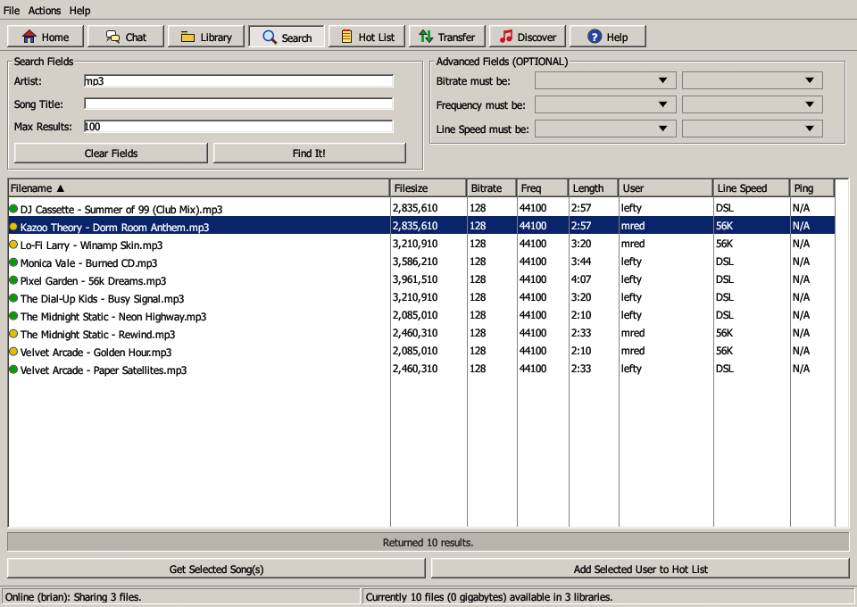
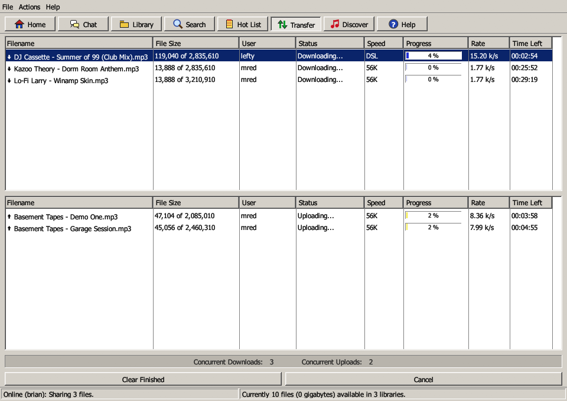
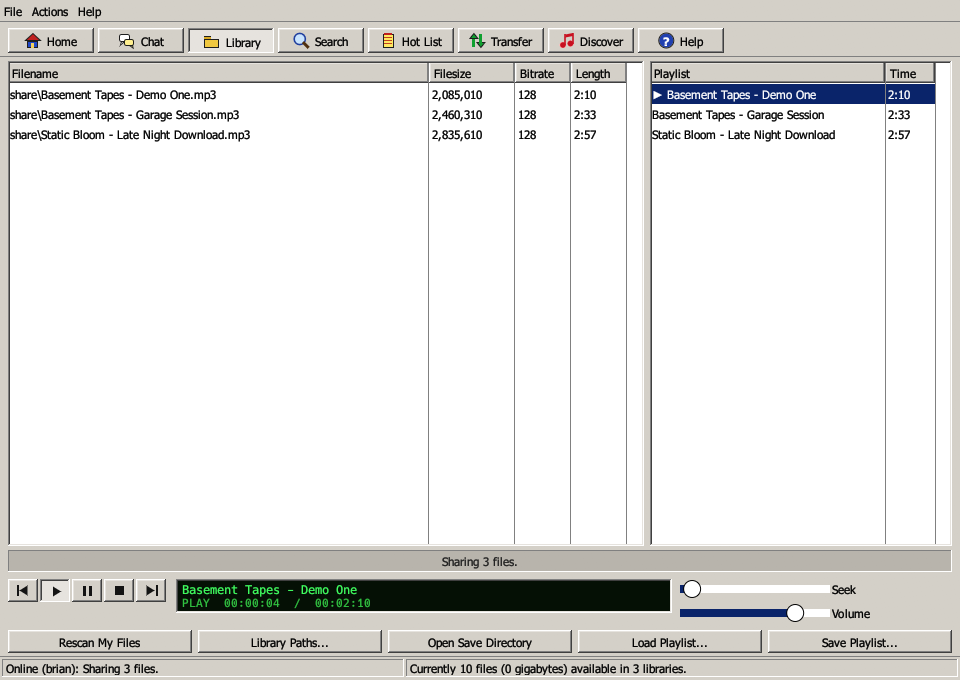
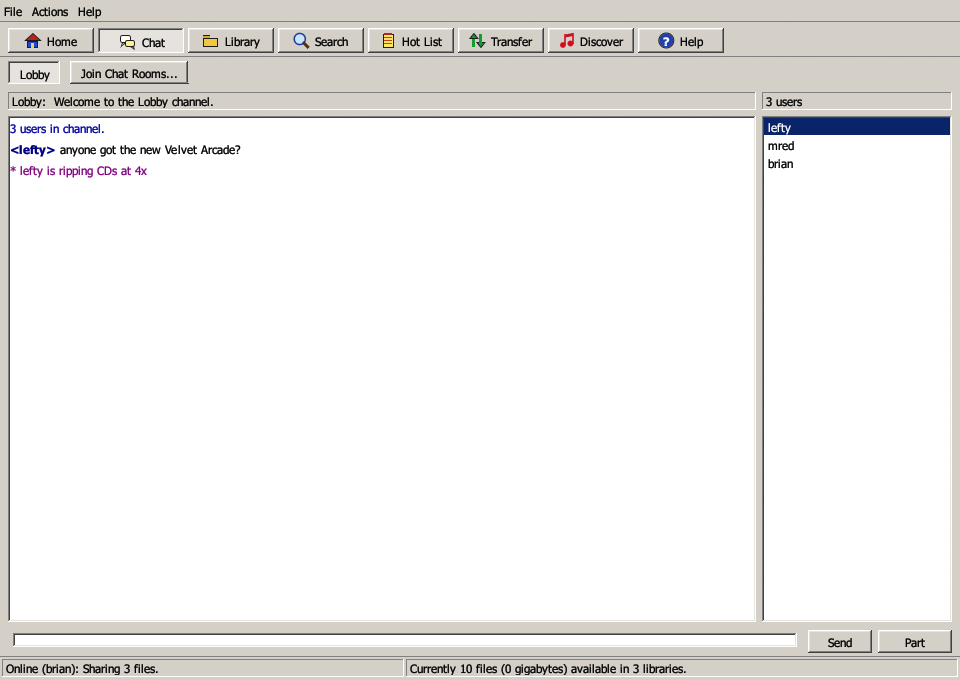

# napster-rs

A Rust rewrite of the **Napster v2.0 BETA 10** Windows client, plus a server
that makes it work again. The protocol was recovered from the original
`napster.exe`; see [docs/PROTOCOL.md](docs/PROTOCOL.md).

The desktop client recreates the look of the 2001 client: Windows 2000
gray, bevelled buttons, the tab row, the Search and Transfer windows, and
the Library with its built-in player.






| Crate | Binary | What it is |
|---|---|---|
| `napster-proto` | | Wire protocol: frame codec, message numbers, field tokenizer, search grammar, and the peer `GET`/`SEND`/`GETLIST` handshakes |
| `napster-server` | `napd` | Server and metaserver: accounts, sharing and search, transfer brokering (including firewalled push), chat rooms, hot lists, whois, moderation, TLS, and linking servers into one network |
| `napster-core` | | Client engine: login (plain, TLS or via SOCKS5), library scan (MP3 parsing and Napster MD5), downloads and uploads with resume, push transfers, direct browse, period-accurate speeds, signed self-update |
| `napster-gui` | `napster` | Desktop client (egui) with the original's tabs: Home, Chat, Library and player, Search, Hot List, Transfer, Discover and Help |
| `napster-cli` | `napster-cli` | Line-based client over the same engine |
| `napster-sign` | `napster-sign` | Signs release packages for auto-update (used by CI) |

## Build

```bash
cargo build --release
```

The binaries end up in `target/release/`: `napd`, `napster` and
`napster-cli`.

### Prebuilt packages (GitHub Actions)

`.github/workflows/build.yml` runs clippy and the tests on Windows, macOS
and Linux for every push to `main` and every pull request. A newer push
cancels a run that's still going for the same branch.

Packages are built only for version tags, or when you start the workflow
by hand (**Actions > build > Run workflow**):

| Package | Contents |
|---|---|
| `napster-rs-windows-x64.zip` | `napster.exe`, `napster-cli.exe` and `napd.exe` |
| `napster-rs-macos-universal.zip` | `Napster.app` and the command-line tools, built for Intel and Apple Silicon |
| `napster-rs-linux-x64.tar.gz` | `napster`, `napster-cli` and `napd` |

A tag such as `v0.4.0` signs them and publishes them as a GitHub release
(see [docs/RELEASING.md](docs/RELEASING.md)). A manual run leaves them,
unsigned, in the run's **Artifacts** section.

The macOS app is signed ad hoc but not notarized, so the first time you
open it you'll need to right-click it and choose **Open**. The Linux
client needs GTK 3 and X11 or Wayland at runtime.

## Run a server

```bash
napd --elite yourname
```

* The main server listens on `0.0.0.0:8888`, unencrypted, for the 2001
  client.
* The encrypted (TLS) port is `0.0.0.0:8889`, for napster-rs clients.
  On first run, `napd` generates a self-signed certificate in its data
  folder and logs its SHA-256 fingerprint. Share that fingerprint with your
  users so they can check it. To use a real certificate (for example from
  Let's Encrypt), pass `--tls-cert fullchain.pem --tls-key privkey.pem`.
  `--no-tls` turns the port off.
* The metaserver (redirector) listens on `0.0.0.0:8875`. It hands out the
  address the client connected on; override that with `--public-host`.
* Accounts and bans are kept in `napd-data/db.json`. Unknown nicks are
  registered on first login. Passwords are hashed with Argon2; accounts
  from before v0.4 are upgraded on their next login.
* `--elite <nick>` gives full admin rights. `--channel <name>` (repeatable)
  sets the predefined rooms, and `--motd motd.txt` sets the message of the
  day.
* `--max-conns-per-ip` (default 8) and `--max-shares` (default 20,000)
  adjust the abuse limits. See [Security](#security).
* Several servers can be linked into one network. See
  [Linking servers](#linking-servers).

People outside your LAN need to reach port 8889 (and 8888 for 2001
clients), plus 8875 if they use the metaserver.

### Linking servers

Like OpenNap networks of the era, several `napd` servers can join into one
network. A user on any server can then:

* search all the servers at once;
* download and browse from users on other servers, including firewalled
  ones;
* send private messages and pings, and look users up with whois;
* chat in shared channels;
* see users on other servers come and go on their hot list.

Nicks are unique across the whole network. Accounts, bans and moderation
stay with each server.

Every server links directly to every other one (a full mesh); nothing is
relayed through a middle server. For three servers A, B and C:

```bash
# A accepts links; it prints its certificate fingerprint at startup
napd --server-name alpha --link-listen 0.0.0.0:8890 --link-password "long shared secret"

# B links to A, and accepts a link from C
napd --server-name beta --link-listen 0.0.0.0:8890 --link-password "long shared secret" \
     --link a.example.org:8890=<A's fingerprint>

# C links to A and B
napd --server-name gamma --link-password "long shared secret" \
     --link a.example.org:8890=<A's fingerprint> --link b.example.org:8890=<B's fingerprint>
```

* **Names:** each server needs a unique `--server-name`.
* **Fingerprints:** `--link host:port=FINGERPRINT` takes the fingerprint
  the other server logs at startup.
* **Password:** `--link-password` must be the same everywhere. You can set
  it in the `NAPD_LINK_PASSWORD` environment variable instead of on the
  command line.

How links are secured:

* **Encrypted:** links run over TLS.
* **Pinned:** each server accepts only the exact certificate fingerprint
  you configured for its peer, so it can't be tricked into talking to an
  impostor.
* **Authenticated:** both servers prove they know the link password with
  an HMAC challenge, so the password itself never crosses the network.

A dropped link reconnects every 10 seconds. While it's down, users on the
other side simply disappear from searches and channels.

## Run the client

```bash
napster
```

On first run, Preferences opens. Set a user name and password, the server
(`host:8888`, or `host:8875` with the metaserver box ticked), your shared
folders and a download folder. The data port defaults to **6699**. Other
users must be able to reach it to download from you. If they can't, set it
to `0` (firewalled) and your uploads will be pushed out instead.

To encrypt your connection, tick **Encrypt the connection (TLS)** in
Preferences and use the server's TLS port, `host:8889`. On the CLI, pass
`--tls`. The first time you connect, the client remembers the server's
certificate. If the certificate ever changes, the client refuses to
connect and warns that someone may be impersonating the server.

If you have to go through a SOCKS5 proxy, fill in **Firewall Settings**
in Preferences:

* **Server and login:** the proxy's server, port and, if it needs one, a
  user name and password.
* **What goes through it:** the server connection, the metaserver lookup
  and the update check always do. File transfers do too unless you
  untick **Also send file transfers through the proxy**.
* **Your DNS lookups:** host names are resolved by the proxy, not your own
  computer.
* **Incoming connections:** other users can't reach you through a proxy,
  so if nothing can connect to you directly, set the data port to `0`.

On the CLI, use `--proxy host:port`, plus `--proxy-user` and
`--proxy-password` if the proxy needs them.

Settings are stored in `%APPDATA%\napster-rs\config.json`, which is shared
with the CLI. Remembered server certificates are in `known_servers.json`
in the same folder.

Chat boxes accept IRC-style commands such as `/join`, `/msg`, `/me`,
`/whois`, `/browse`, `/ping` and `/raw <numeric> <data>`. Type `/help` for
the full list.

### The player

The **Library** tab doubles as the original's "My Files & Player":

* **Playing:** double-click a song in My Files (or right-click it and
  choose **Add to Playlist**) to queue it in the playlist on the right.
* **Controls:** the bar underneath has previous, play, pause, stop and
  next buttons, a green LCD-style display showing the song and time, and
  seek and volume sliders. Songs play through in order.
* **Playlists:** **Load Playlist...** and **Save Playlist...** read and
  write M3U and PLS files.
* **Finished downloads:** double-click one in the Transfer tab to play it.
* **Formats:** MP3, WAV, FLAC and Ogg Vorbis. The original played WMA
  through Windows Media; that isn't supported.

### CLI

```bash
napster-cli --server myhost:8888 --nick bob --password pw --share D:\Music
```

Then use `/search beatles`, `/get 1 2`, `/transfers`, `/join Lobby`, and so
on. `/help` lists everything.

## Authentic 1999 speeds

In the original client, **Line Speed** was only a label: you could claim
T1 while on a 28.8 modem. In napster-rs it really limits your transfers,
so downloading a song can take as long as it did then. This is on by
default. To turn it off, uncheck **Authentic speeds** in Preferences >
Transfer Settings, or pass `--modern-speeds` to the CLI.

| Line Speed | Downloads | Uploads | One 4 MB song |
|---|---|---|---|
| 14.4 Kbps | 1.6 KB/s | 1.6 KB/s | ~43 min |
| 28.8 Kbps | 3.2 KB/s | 3.2 KB/s | ~21 min |
| 33.6 Kbps | 3.8 KB/s | 3.6 KB/s | ~18 min |
| 56K | 5.0 KB/s | 3.5 KB/s | ~14 min |
| ISDN-64K | 7.5 KB/s | 7.5 KB/s | ~9 min |
| ISDN-128K | 15 KB/s | 15 KB/s | ~4.5 min |
| Cable | 150 KB/s | 16 KB/s | ~27 s |
| DSL | 90 KB/s | 15 KB/s | ~45 s |
| T1 | 180 KB/s | 180 KB/s | ~23 s |
| T3 | 5,000 KB/s | 5,000 KB/s | <1 s |
| Unknown | unlimited | unlimited | |

These are the speeds connections of the time actually sustained, not
their advertised ratings:

* Modems never reached their rated speed.
* 56K modems could only send at 33.6K.
* Home DSL and cable had fast downloads but uploads capped near 128 Kbps.

Things that work the way they did on a real connection:

* **One shared line.** The limit covers all your transfers together.
  Two downloads on 56K each get about 2.5 KB/s.
* **The slower side sets the pace.** If you're on DSL and download
  from someone on 56K, you get their 3.5 KB/s upload speed.
* **Changes apply right away.** A new Line Speed takes effect on
  transfers already in progress.

With authentic speeds off, you can set your own totals instead: **Max
Download Speed** and **Max Upload Speed** in KB/s, where 0 means
unlimited. On the CLI, use `--download-limit` and `--upload-limit`.

```bash
napster-cli --line-speed 4 --server myhost:8888 --nick modemguy --password pw
```

`--line-speed` takes 0–10: 0 Unknown, 1 14.4, 2 28.8, 3 33.6, 4 56K,
5 ISDN-64K, 6 ISDN-128K, 7 Cable, 8 DSL, 9 T1, 10 T3.

## Using the original 2001 client

The b10 client has `server.napster.com` (and `server2.napster.com`) built
in and contacts the metaserver on port 8875. To point it at `napd`, add a
hosts-file entry (`C:\Windows\System32\drivers\etc\hosts`):

```
192.168.1.10  server.napster.com
192.168.1.10  server2.napster.com
```

Then start the old client. `napd` speaks the same messages, including the
607/608 upload-request handshake that b10 uses. Not yet tested against
the original binary.

## Tests

```bash
cargo test --workspace
```

The end-to-end tests in `crates/napster-core/tests/` start real `napd`
servers and real client engines on loopback.

`e2e.rs` covers:

* search and download, checked byte for byte
* a firewalled uploader pushing a file
* resuming a partial download
* direct browse, normal and firewalled
* chat, private messages and hot-list notifications
* login through the metaserver, including a wrong password
* download speed caps and period-accurate line speeds

`security.rs` covers:

* TLS certificate pinning and impersonation detection
* failed-login lockout and the sign-up limit
* connection, flood and share limits
* refusing non-audio downloads

`proxy.rs` covers logging in, searching and downloading through a SOCKS5
proxy that requires a password.

`linking.rs` covers two linked servers:

* searching, downloading and browsing across servers
* private messages, pings and whois
* shared channels and hot lists
* unique nicks across the network
* refusing a server with the wrong link password or certificate

### Automatic updates

By default, the client checks this repository's GitHub releases when it
starts. If there's a newer version, it asks before doing anything:
**Update Now** downloads, checks and installs it, then offers to restart.
You can also use **Help > Check for Updates...** or type `/update` in the
CLI. To turn off the startup check, uncheck **Check for new versions** in
Preferences.

Updates are signed:

* The release build signs every package with an Ed25519 key that only
  GitHub Actions has.
* The client checks that signature against a public key built into it,
  and refuses anything that doesn't match.
* A tampered package or a fake release is rejected, even if someone
  gains control of the GitHub account.

The original 2001 client had an "auto-upgrade" that installed whatever
the server pointed it to, without asking. napster-rs ignores that.

On Windows and Linux, the update replaces `napster`, `napster-cli` and
`napd` in the same folder. On macOS it replaces the whole `Napster.app`.

To install a downloaded package by hand, keep its `.sig` file next to
it and run:

```bash
napster-cli --apply-update napster-rs-windows-x64.zip
```

Updates only work while the repository is public. See
[docs/RELEASING.md](docs/RELEASING.md) for how releases and signing keys
work.

### Screenshots of every screen

Set `NAPSTER_SNAPSHOT_DIR` to make the GUI capture itself and exit. With
this set, it:

1. logs in using the given config
2. searches for `NAPSTER_SNAPSHOT_SEARCH` (default `mp3`)
3. starts a few downloads
4. saves a PNG of every tab and dialog to that directory

```bash
NAPSTER_SNAPSHOT_DIR=shots napster --config test-user.json
```

Add `NAPSTER_SNAPSHOT_PLAY=1` to start the player before the Library shot
is taken. Only use it with silent test files: playback goes through your
speakers.

## Security

The original Napster protocol had no security at all. Here's what
napster-rs adds, and what it can't fix.

**Between the client and the server**

* **Encryption:** traffic can go over TLS (port 8889). Without it,
  passwords, chat and searches cross the network unencrypted.
* **Server identity:** a certificate from a public certificate authority is
  checked normally. A self-signed one is remembered on first use, and the
  client refuses to connect if it changes.
* **Passwords:** stored with Argon2, a slow hash designed for passwords.
* **Failed-login lockout:** after 5 wrong passwords, an address is locked
  out for 10 minutes. Each address can also create at most 5 accounts per
  hour.
* **Connection limits:** at most 8 connections per address, and 5,000 in
  total.
* **Server links:** links between servers use TLS with pinned
  certificates and HMAC authentication. See
  [Linking servers](#linking-servers).
* **Flood protection:** each connection may send 20 messages a second, with
  bursts up to 200. File-sharing messages are exempt. Excess messages are
  dropped, and persistent flooders are disconnected.
* **Resource caps:** each user can share at most 20,000 files and be in at
  most 20 channels. The server allows at most 500 user-created channels.

**Between users (file transfers)**

* **Shared files only:** peers can only fetch files you share, by their
  exact names. Nothing else on your disk is reachable.
* **Private folder paths:** your files are listed as
  `<shared folder>\Artist\Song.mp3`, never by full path. Others can't learn
  your Windows user name or folder layout. (The 2001 client sent full
  paths; when browsing such a user, napster-rs shows only the file name.)
* **Verified browsing:** a direct browse checks that the program it
  reached really belongs to the user you asked for. Without this, two
  clients sharing a data port on one computer could show your own files
  as theirs.
* **Audio only:** the client refuses to download anything that isn't an
  audio file, so a `song.mp3.exe` never arrives. **Open** only plays audio
  files; anything else is shown in its folder, never run.
* **Safe file names:** downloaded file names are cleaned so they can't
  write outside your download folder.
* **Size checks:** a peer must send the file size it advertised, and a
  download won't start without enough free disk space.
* **No connecting into your network:** when the server is on the internet,
  the client won't connect to private addresses on your network on its
  instructions. A malicious server can't use your client to probe your
  LAN.
* **Connection cap:** at most 32 incoming peer connections can be setting up
  at once.
* **Dangerous commands ignored:** the original protocol's "auto-upgrade"
  and "connection test" commands are ignored. Updates come only from signed
  GitHub releases.

**What it can't fix**

* **Your IP address is visible.** Anyone you trade with sees your IP
  address. That's how peer-to-peer works.
* **File transfers aren't encrypted.** They use the original protocol and
  aren't encrypted. The files are shared publicly anyway, but someone
  watching your network can see what you download.
* **The 2001 client can't use TLS.** If you don't need it, run `napd` with
  `--listen 127.0.0.1:8888` to keep the unencrypted port local.
* **A server operator can see everything** that passes through their
  server, encrypted or not. On a linked network, that includes every
  server in the network.

## Deliberately left out

* **Auto-upgrade (message 5).** It made the 2001 client download and run
  any program a server pointed it to. napster-rs updates itself only from
  signed GitHub releases, and only after you agree (see
  [Automatic updates](#automatic-updates)).
* **Connection tests (messages 900/901).** They let a server make clients
  open connections, or listen on ports, of the server's choosing.
* **WMA playback.** It needs Windows Media; WMA files can still be shared
  and downloaded.
